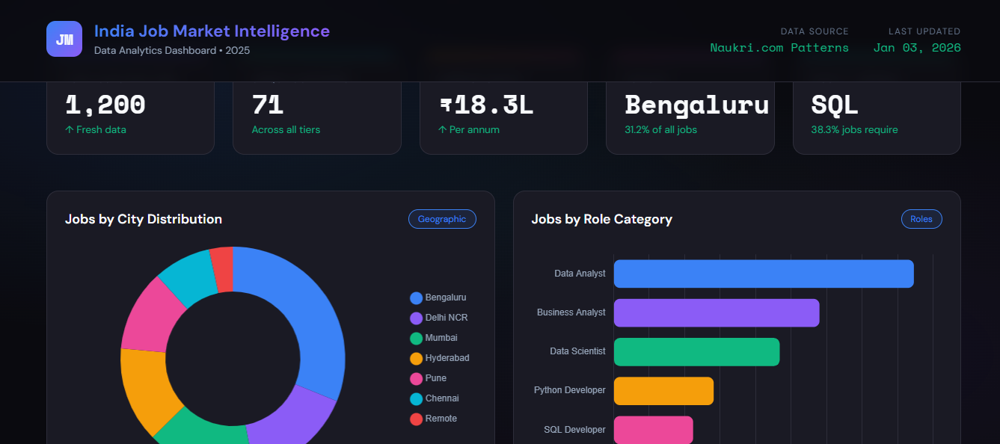
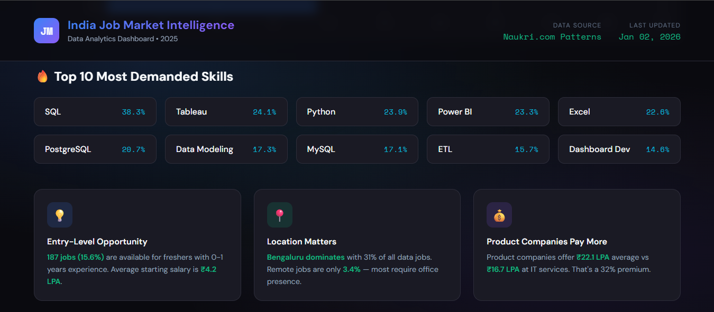
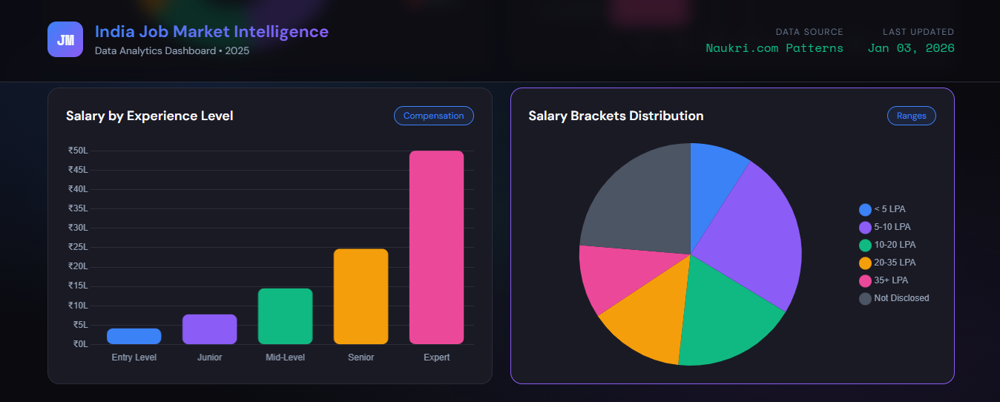
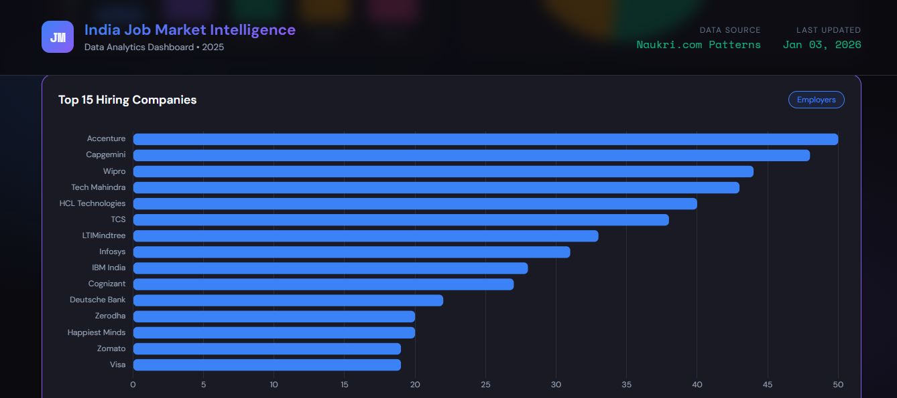

# 🇮🇳 Data-Hire — India Data Jobs Market Intelligence & Analysis

[](https://www.python.org/)
[](https://www.sqlite.org/)
[](https://pandas.pydata.org/)
[](https://www.chartjs.org/)
[](https://www.tableau.com/)
[](https://opensource.org/licenses/MIT)

> **An end-to-end data analytics and market intelligence platform analyzing 1,200+ job listings across India to uncover hiring dynamics, compensation benchmarks, geographic hotspots, and high-ROI technical skill requirements.**

---

## 📌 Executive Summary

The Indian data and analytics sector is rapidly evolving, yet job seekers, students, and recruiters often operate with fragmented salary data and unclear skill requirements. **Data-Hire** solves this by delivering an end-to-end analytics pipeline that parses, cleans, normalizes, and visualizes market intelligence across **1,200+ job postings** from top tech enterprises, multinational corporations, and high-growth product firms.

### 🎯 Key Benchmark Metrics

| Metric | Benchmark Value | Market Insight |
|:-------|:----------------|:---------------|
| **Total Jobs Analyzed** | **1,200** | Comprehensive sample spanning 5 core data profiles |
| **Unique Companies** | **71** | Mix of product giants, global MNCs, startups, and IT services |
| **Overall Average Salary** | **₹18.3 LPA** | Across disclosed compensation packages |
| **Top Tech Hub** | **Bengaluru (31.2%)** | Dominant hub followed by Delhi NCR and Mumbai |
| **#1 In-Demand Skill** | **SQL (38.3%)** | Foundation prerequisite across virtually all data roles |
| **Remote Opportunities** | **3.4%** | Market heavily favors on-site and hybrid arrangements |

---

## 🖥️ Interactive Dashboard Showcase

The project features a lightweight, standalone, and interactive web dashboard built with **HTML5, CSS3, and Chart.js**, powered by dynamic client-side datasets.

| Main Dashboard Overview | Skill Demand Heatmap |
| :---: | :---: |
|  |  |

| City & Role Distributions | Salary Trends & Experience Bands |
| :---: | :---: |
|  |  |

---

## 🔥 Key Market Insights & Findings

### 1. Most In-Demand Skills Across Data Roles
SQL and modern BI tools lead the market requirements. Mastery of SQL coupled with either Tableau or Power BI represents the baseline stack for over 60% of openings.

```text
1. SQL                   ████████████████████  38.3% (460 jobs)
2. Tableau               ████████████          24.1% (289 jobs)
3. Python                ████████████          23.9% (287 jobs)
4. Power BI              ███████████           23.3% (280 jobs)
5. Excel                 ███████████           22.6% (271 jobs)
6. PostgreSQL            ██████████            20.7% (248 jobs)
7. Data Modeling         █████████             17.3% (207 jobs)
8. MySQL                 █████████             17.1% (205 jobs)
9. ETL Architectures     ████████              15.7% (188 jobs)
10. Dashboard Dev        ███████               14.6% (175 jobs)
```

### 2. Compensation Curve by Experience Level
Compensation scales rapidly with domain expertise, with significant inflection points occurring at the mid-level (3–5 years) and expert (8+ years) tiers.

| Career Level | Experience Span | Average Salary | Typical Salary Range | Open Positions |
|:---|:---:|:---:|:---:|:---:|
| **Entry Level** | 0 – 1 Years | **₹4.2 LPA** | ₹3.4 – ₹5.3 LPA | 139 jobs |
| **Junior** | 1 – 3 Years | **₹7.8 LPA** | ₹6.3 – ₹9.8 LPA | 265 jobs |
| **Mid-Level** | 3 – 5 Years | **₹14.5 LPA** | ₹11.7 – ₹18.2 LPA | 217 jobs |
| **Senior** | 5 – 8 Years | **₹24.7 LPA** | ₹20.3 – ₹31.5 LPA | 150 jobs |
| **Expert / Lead** | 8+ Years | **₹50.0 LPA** | ₹33.8 – ₹84.0 LPA | 145 jobs |

### 3. Product vs. Service Sector Premium
Product-focused companies offer an average premium of **32%** over traditional IT services firms:
- **Product Companies** (e.g., Zerodha, Swiggy, Google India): **₹22.1 LPA** average
- **Global Capability Centers & MNCs** (e.g., Visa, Deutsche Bank): **₹19.6 LPA** average
- **Venture-Backed Startups** (e.g., Freshworks, CRED): **₹17.1 LPA** average
- **Tier-1 IT Services** (e.g., TCS, Infosys, Accenture): **₹16.7 LPA** average

### 4. Geographic Distribution of Openings
Data roles remain highly centralized within Tier-1 technology clusters:
- **Bengaluru**: **31.2%** (374 postings) — The undisputed analytics capital
- **Delhi NCR**: **15.8%** (190 postings) — High demand in consulting and fintech
- **Mumbai**: **15.7%** (188 postings) — Banking, financial services, and insurance (BFSI)
- **Hyderabad**: **13.8%** (166 postings) — Cloud infrastructure and MNC hubs
- **Pune**: **11.8%** (141 postings) — Automotive, industrial data, and IT engineering
- **Chennai**: **8.3%** (100 postings) — Enterprise software and SaaS
- **Remote**: **3.4%** (41 postings) — On-site presence is strongly preferred post-2024

---

## 🛠️ Technology Stack & Pipeline Architecture

```
[Raw Job Listings / Naukri API]
             │
             ▼
   [Python 3.8+ & Pandas]  ──> Data Cleaning, Feature Engineering & Parsing
             │
             ▼
   [SQLite Relational DB]  ──> Dual-table schema (`jobs` & normalized `job_skills`)
             │
    ┌────────┴────────────────────────┬────────────────────────┐
    ▼                                 ▼                        ▼
[SQL Analytics Engine]       [Client Data Export]      [Tableau BI Feeds]
(Complex Aggregate Queries)    (`dashboard_data.js`)    (Pre-aggregated CSVs)
                                      │
                                      ▼
                        [Interactive HTML5/Chart.js]
```

| Layer | Tools & Libraries | Key Responsibilities |
|:---|:---|:---|
| **Data Ingestion** | Python, Requests, JSON | Automated API scraping & representative synthetic sampling |
| **Data Cleaning** | Pandas, NumPy, Regular Expressions | Salary bracket normalization, experience parsing, and skill tokenization |
| **Storage & Modeling** | SQLite 3 (`india_jobs.db`) | Relational database schema with primary and foreign key lookups |
| **Analytics Engine** | Standard SQL | Aggregations, window functions, ranking queries, and trend extraction |
| **Interactive UI** | HTML5, CSS3, JavaScript, Chart.js | Responsive dark-mode dashboard with interactive charts |
| **Business Intelligence** | CSV Exports | Pre-configured, high-performance feeds ready for Tableau Desktop/Public |

---

## 📁 Repository Structure

```text
Data-Hire---India-Data-Jobs-Analysis/
│
├── data/
│   ├── india_jobs_raw.csv           # Raw collected dataset (1,200 records)
│   ├── india_jobs_cleaned.csv       # Cleaned dataset (24 enriched feature columns)
│   ├── skills_analysis.csv          # Aggregate skill frequency and percentage data
│   ├── india_jobs.db                # Relational SQLite database (`jobs`, `job_skills`)
│   └── dashboard_data.js            # Standalone JSON payload for zero-dependency web dashboard
│
├── output/
│   ├── dashboard.html               # Interactive dark-mode analytical dashboard
│   ├── tableau_jobs.csv             # Tableau-ready primary dataset
│   ├── tableau_skills.csv           # Specialized skills dataset for BI visualizers
│   ├── tableau_city_role.csv        # Geographic role matrix
│   └── tableau_salary_trends.csv    # Experience vs. salary trend extracts
│
├── sql/
│   └── analysis_results.txt         # Executed SQL query outputs and statistical logs
│
├── scripts/
│   ├── 01_data_collection.py        # Naukri API ingestion script
│   ├── 02_generate_dataset.py       # Market-representative dataset synthesizer
│   ├── 03_data_cleaning.py          # Data cleaning, deduplication & feature engineering
│   ├── 04_sql_analysis.py           # SQLite database builder & analytical query runner
│   └── 05_export_dashboard_data.py # Client-side JS data packager for dashboard
│
├── dashboard_preview.png            # Main dashboard overview screenshot
├── dashboard_charts.png             # Role and city distribution charts
├── dashboard_charts2.png            # Salary breakdown charts
├── dashboard_skills.png             # Top technical skills matrix
├── .gitignore                       # Git ignore configuration
└── README.md                        # Project documentation
```

---

## 🚀 Getting Started & Execution Guide

### 1. Prerequisites
Ensure you have **Python 3.8+** installed. Install the necessary analysis libraries:

```bash
pip install pandas numpy requests
```

### 2. Clone the Repository
```bash
git clone https://github.com/Rakshi1808/Data-Hire---India-Data-Jobs-Analysis.git
cd Data-Hire---India-Data-Jobs-Analysis
```

### 3. Run the Data Pipeline

Execute the pipeline sequentially from the root directory:

```bash
# Step 1: Generate or collect dataset
python scripts/02_generate_dataset.py

# Step 2: Clean data and engineer features
python scripts/03_data_cleaning.py

# Step 3: Populate SQLite database and execute SQL analytics
python scripts/04_sql_analysis.py

# Step 4: Export cleaned payload for the interactive dashboard
python scripts/05_export_dashboard_data.py
```

### 4. Launch the Interactive Dashboard
Open `output/dashboard.html` directly in any modern browser:

- **Windows**:
  ```powershell
  Start-Process output/dashboard.html
  ```
- **macOS**:
  ```bash
  open output/dashboard.html
  ```
- **Linux**:
  ```bash
  xdg-open output/dashboard.html
  ```

*(Or simply navigate to the `output/` folder in your file explorer and double-click `dashboard.html`.)*

---

## 📈 SQL Analytics Showcase

The analysis pipeline leverages SQLite to execute relational aggregations. Below are sample queries from `scripts/04_sql_analysis.py`:

### Top 10 In-Demand Skills Query
```sql
SELECT 
    skill,
    COUNT(*) AS job_count,
    ROUND(COUNT(*) * 100.0 / (SELECT COUNT(DISTINCT job_id) FROM job_skills), 1) AS demand_percentage
FROM job_skills
GROUP BY skill
ORDER BY job_count DESC
LIMIT 10;
```

### Compensation Benchmarking by Company Tier
```sql
SELECT 
    company_tier,
    COUNT(*) AS total_postings,
    ROUND(AVG(salary_avg), 1) AS avg_salary_lpa,
    ROUND(MIN(salary_min), 1) AS min_salary_lpa,
    ROUND(MAX(salary_max), 1) AS max_salary_lpa
FROM jobs
WHERE salary_avg IS NOT NULL
GROUP BY company_tier
ORDER BY avg_salary_lpa DESC;
```

---

## 🎓 Actionable Career Takeaways

1. **Prioritize SQL Above All**: SQL appears in nearly 40% of all data job descriptions. It is non-negotiable for Data Analysts, BI Engineers, and Data Scientists alike.
2. **Pair SQL with a Modern BI Tool**: Tableau (24.1%) and Power BI (23.3%) enjoy equal prominence. Mastery of either tool provides an immediate hiring advantage.
3. **Target Bengaluru for Maximum Volume**: Over 31% of nationwide openings are concentrated in Bengaluru, followed by Delhi NCR and Mumbai.
4. **Target Product Companies & MNC GCCs**: Product companies pay a ~32% premium (₹22.1 LPA vs. ₹16.7 LPA) over traditional IT services.
5. **Freshers Have Significant Opportunity**: 139 dedicated entry-level roles (averaging ₹4.2 LPA) were cataloged, primarily centered on Data Analyst and Business Analyst profiles.

---

## 🔮 Roadmap & Future Enhancements

- [ ] Automated real-time scraping via GitHub Actions with scheduled cron triggers
- [ ] Predictive salary modeling using Scikit-Learn (gradient boosting / regression)
- [ ] Interactive skill-gap calculator for prospective applicants
- [ ] Automated weekly market summary reports emailed via headless workers
- [ ] Tableau Public live dashboard deployment with interactive filters

---

## 👩‍💻 Author & Developer

**Amaragonda Rakshitha**
- 🎓 **Education**: MCA Student at National Institute of Technology (NIT) Kurukshetra
- 📍 **Location**: Hyderabad, Telangana, India
- 💼 **Focus Area**: Aspiring Data Engineer & Analytics Specialist
- 🔗 **GitHub**: [@Rakshi1808](https://github.com/Rakshi1808)
- 📂 **Project Repository**: [Data-Hire---India-Data-Jobs-Analysis](https://github.com/Rakshi1808/Data-Hire---India-Data-Jobs-Analysis)

---

## ⭐ Support & Acknowledgments

If you found this analysis helpful or insightful for your own career planning, please consider giving this repository a **star** ⭐!

*Crafted with precision for the Indian data analytics community.*
